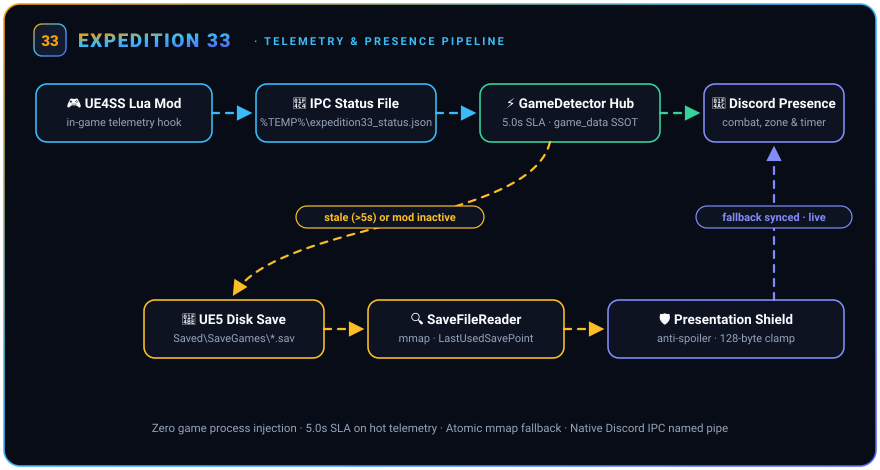
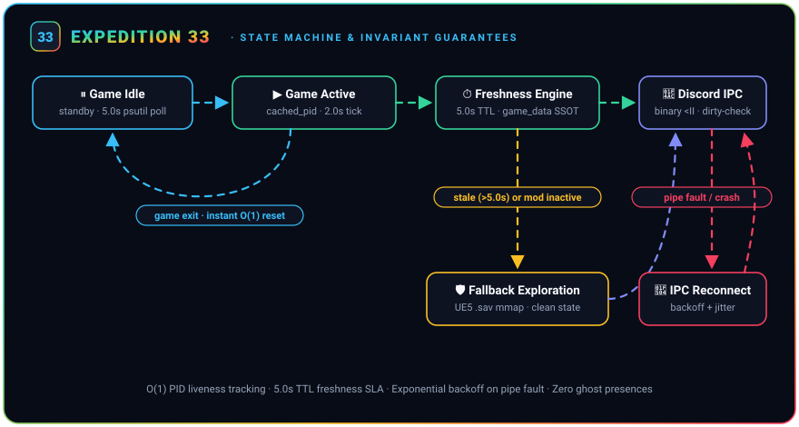
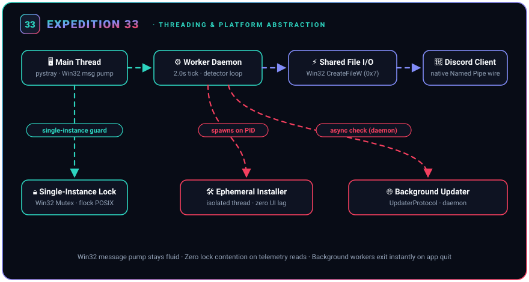

# Architecture & System Design: Expedition33_RPC

This document defines the architectural mental model, module hierarchy, state machine invariants, and frozen contracts of `expedition33-discord-rpc`.

---

## 1. 5-Minute Mental Model

<p align="center">
  
</p>

The application operates as a deterministic, unidirectional data pipeline:

1. **Watcher & Ingestion**: Detects game process (`SandFall-Win64-Shipping.exe` / `SandFall-WinGDK-Shipping.exe`). Reads telemetry file written by the UE4SS Lua mod using non-blocking Win32 shared reads (`0x7`).
2. **State Engine**: Validates freshness against a strict 5.0s TTL. Resolves raw map and flag tokens against immutable catalog mappings (`assets/game_data.json`), producing an immutable `GameState` snapshot.
3. **Presentation**: Pure functional mapping from `GameState` to `PresencePayload` DTO according to active localization and anti-spoiler settings.
4. **Discord IPC & UI**: Dispatches formatted payload to Discord's local named pipe via binary `<II` framing only when dirty. Updates system tray status asynchronously.

---

## 2. Unified Modular Architecture (SSOT)

All source code lives under `src/expedition33_rpc/`. This structure is the project's single source of truth:

```text
src/expedition33_rpc/
├── __init__.py               # Public API exports (__version__, main, GameDetector, GameState)
├── __main__.py               # Entrypoint execution (`python -m expedition33_rpc`)
│
├── core/                     # Application lifecycle, platform primitives & orchestrator
│   ├── app.py                # Single-instance application bootstrap and clean shutdown
│   ├── orchestrator.py       # Headless AppOrchestrator coordinating detector, IPC, and UI
│   ├── platform.py           # OS abstraction: Win32 mutex, flock, CreateFileW 0x7, winreg
│   ├── presence.py           # Decoupled immutable PresencePayload DTO
│   ├── resources.py          # PyInstaller bundle (_MEIPASS) and development path resolution
│   ├── settings.py           # Persistent JSON user preferences
│   ├── smoke.py              # Startup validation and sanity verification
│   └── startup.py            # Windows autostart (HKCU Run key) manager
│
├── detection/                # Game telemetry ingestion, detection & normalization
│   ├── compat_paths.py       # Cross-platform IPC paths (Windows, Linux, Steam Deck Proton)
│   ├── detector.py           # GameDetector, BridgeStateProvider & immutable GameState
│   ├── game_data.py          # SSOT catalog accessors, regexes & Endless Tower matchers
│   ├── normalization.py      # Pure normalization routines for levels, checkpoints, and bosses
│   ├── save_reader.py        # Checkpoint resolver & fallback parser for binary UE5 .sav files via mmap
│   └── timer_tracker.py      # ZoneTimerTracker state machine for persistent Discord timestamps
│
├── integrations/             # External boundaries and daemon installers
│   ├── bridge_installer.py   # Automatic and manual UE4SS Lua mod bridge deployment
│   ├── discord_rpc.py        # Native Discord IPC client with binary <II framing & rate limits
│   └── updater.py            # GitHub Releases auto-update checker and background worker
│
├── ui/                       # Presentation layer and graphical shell
│   ├── presentation.py       # Pure formatting functions for Discord status and tray text
│   └── tray_app.py           # System tray menu, background polling pump, and user actions
│
└── assets/                   # Bundled static data and binaries
    ├── bridge.zip            # Pre-compiled headless UE4SS mod package
    ├── game_data.json        # Single Source of Truth localization and entity dictionary
    ├── icon.ico              # Windows executable icon
    └── icon.png              # System tray icon
```

---

## 3. Asynchronous State Machine & Invariant Guarantees

<p align="center">
  
</p>

<p align="center">
  
</p>

The application runtime maintains resilient execution across host process faults through strict invariant handling:

### Critical Invariants:
1. **Discord Crash & Disconnect**:
   - Outbound writes detect broken pipes (`BrokenPipeError`, `OSError`).
   - The connection transitions to `DISCONNECTED` immediately.
   - Reconnection runs with exponential backoff and jitter without interrupting the game detection worker loop.
2. **Game Closure / Crash**:
   - The active loop polls `cached_pid` with $O(1)$ efficiency.
   - Upon process exit, `AppOrchestrator` resets state instantly, clears `cached_pid`, transmits an empty/cleared Rich Presence frame to Discord, and drops back to the 5.0s idle cadence.
3. **Telemetry Freshness SLA (TTL 5.0s)**:
   - Status JSON files carry a mandatory Unix epoch `timestamp`.
   - If `abs(current_time - telemetry.timestamp) > 5.0`, telemetry is marked stale.
   - When telemetry is stale or missing, the state machine drops active combat/boss status to prevent ghost presences and falls back to zone exploration or `.sav` checkpoint inspection.
4. **Frame Dirty-Checking**:
   - Presence payloads are hashed/compared against the previous broadcast frame. Identical states are not re-sent, preventing pipe saturations and Discord rate-limit throttling.
5. **Startup & Telemetry Liveness (`has_received_telemetry`)**:
   - Upon initial process detection before UE4SS writes the first frame, the state engine sets `is_starting = True` ("Starting... / Loading...").
   - Once the first valid telemetry payload is ingested, `has_received_telemetry` locks `True` for the lifetime of that PID.
   - Any transient telemetry stall or file contention falls back to zone exploration of the last known zone (`last_raw_zone`) and never regresses to the starting/loading screen state.
6. **Dynamic Checkpoint Synchronization**:
   - When telemetry contains an empty checkpoint string, `SaveFileReader` inspects the active player save profile.
   - Fast-travel and save-point rests are detected in sub-millisecond time via $O(1)$ `st.st_mtime` file caching on `EXPEDITION_*.sav`, dynamically updating checkpoint labels across both intra-zone and inter-zone travel without polling overhead.

---

## 4. The 4 Frozen Contracts

These four contracts are immutable boundaries. Modifications require explicit approval and compatibility guarantees.

### 4.1. UE4SS Telemetry IPC JSON (`%TEMP%\expedition33_status.json`)
Written atomically by the client-side UE4SS Lua mod in UTF-8:
```json
{
  "timestamp": 1727788800.0,
  "raw_zone": "Level_Main_OldLumiere",
  "zone": "Level_Main_OldLumiere",
  "in_combat": true,
  "enemy_name": "Duollistes",
  "enemies": ["Duollistes", "Glaive"],
  "checkpoint": "Level.SpawnPoint.Camp01",
  "floor": null,
  "tower_floor": null,
  "tower_trial": [11, 3]
}
```
- `timestamp`: Float epoch time; checked against 5.0s TTL. Emitted every second as an active heartbeat during combat.
- `raw_zone` / `zone`: UE5 internal level identifier.
- `in_combat`: Boolean state toggle.
- `enemy_name` / `enemies`: Encounter targets.
- `checkpoint`: Spawn tag mapped in `game_data.json` (delegated to `SaveFileReader` when empty).

### 4.2. Discord Native IPC Binary Frame (`<II`)
Discord Named Pipe (`\\.\pipe\discord-ipc-0`..`9` on Windows, UNIX socket on POSIX) packet wire format:

| Field | Wire Type & Layout | Size | Semantics & Format |
| :--- | :--- | :---: | :--- |
| **Opcode** | `uint32` (Little-Endian) | 4 Bytes | Packet operation type (`OP_HANDSHAKE=0`, `OP_FRAME=1`, `OP_CLOSE=2`, `OP_PING=3`, `OP_PONG=4`) |
| **Length** | `uint32` (Little-Endian) | 4 Bytes | Length in bytes of the following serialized JSON payload |
| **Payload** | UTF-8 JSON Byte String | `Length` Bytes | Compact UTF-8 JSON payload (`{"cmd": "SET_ACTIVITY", "args": ...}`) |

Header packing format: `struct.pack("<II", opcode, length)`.
- Standard opcodes: `HANDSHAKE = 0`, `FRAME = 1`, `CLOSE = 2`, `PING = 3`, `PONG = 4`.
- Field limits: Strings in `details`, `state`, and tooltips are bounded to **128 UTF-8 bytes**, safely sliced at code point boundaries by `truncate_presence_field`.

### 4.3. SSOT Static Catalog (`assets/game_data.json`)
Central repository for all static entities and translations:
- `target_process_names`: Canonical list of executable targets.
- `main_menu_tokens`: Substrings identifying title and loading screens.
- `localized_presentation`: Multilingual format strings across all supported languages.
- `zone_name_overrides_by_lang`: Maps raw level strings to human-facing zone titles.
- `checkpoint_names_by_lang`: Maps 765 UE5 flag identifiers to localized checkpoint names.
- `endless_tower_trials`: Stage, trial, and boss encounter lookup tables.

### 4.4. Windows Autostart Registry Contract
Startup persistence is registered under `HKEY_CURRENT_USER` (requiring zero administrator privileges):

| Registry Parameter | Specification |
| :--- | :--- |
| **Hive** | `HKEY_CURRENT_USER` (HKCU) |
| **Subkey Path** | `Software\Microsoft\Windows\CurrentVersion\Run` |
| **Value Name** | `Expedition33_DiscordRPC` |
| **Type** | `REG_SZ` |
| **Payload Value** | `"C:\Path\To\Expedition33_RPC.exe"` *(points to `pythonw.exe` in development)* |
In development mode, points to `pythonw.exe` to suppress console allocation.

---

## 5. Dry-Run Test Harness Design

The codebase decouples domain logic from OS system calls and external sockets through dedicated test doubles located in `tests/harness/`:

- **`FakeProcessScanner`**: Simulates process discovery, lifecycle state transitions, PID allocation, and abrupt crashes without launching external executables.
- **`FakeBridgeProvider`**: Injects synthetic telemetry payloads and triggers edge-case timings (e.g. stale timestamps, corrupt JSON, missing keys).
- **`DiscordPipeSimulator`**: Acts as a loopback Discord Named Pipe server in-memory, asserting opcode sequences, verifying `<II` packet parsing, and simulating pipe dropouts or invalid responses.

This enables sub-second, 100% deterministic end-to-end integration test execution across macOS, Linux, and Windows in CI without requiring the game or Discord to be installed.
