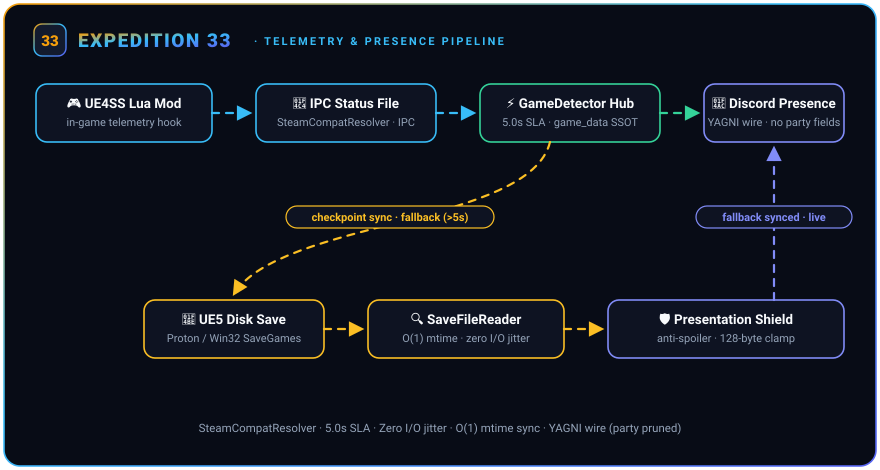
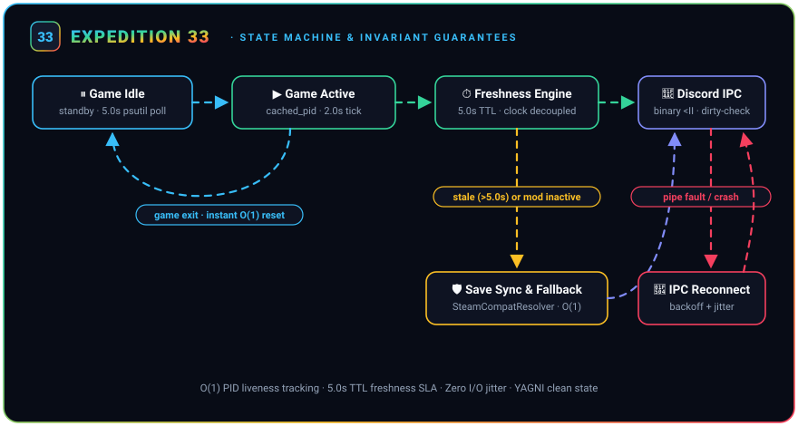
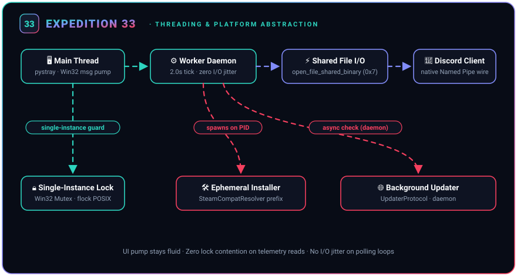

# Architecture & System Design: Expedition33_RPC

This document defines the architectural mental model, module hierarchy, state machine invariants, and frozen contracts of `expedition33-discord-rpc`.

---

## 1. 5-Minute Mental Model

<p align="center">
  
</p>

The application operates as a deterministic, unidirectional data pipeline:

1. **Watcher & Ingestion**: Detects game process (`SandFall-Win64-Shipping.exe` / `SandFall-WinGDK-Shipping.exe`). Reads telemetry file written by the UE4SS Lua mod using non-blocking Win32 shared reads (`0x7`).
2. **State Engine**: Validates freshness against a strict 5.0s TTL. Resolves raw map and flag tokens against immutable catalog mappings (`assets/game_data.json`), producing an immutable `GameState` snapshot.
3. **Presentation**: Pure functional mapping from `GameState` to `PresencePayload` DTO according to active localization and anti-spoiler settings. Definitively pruned of all speculative multiplayer fields (`party_id` and `party_size` are permanently eliminated from `PresencePayload` and the Discord IPC wire payload).
4. **Discord IPC & UI**: Dispatches formatted payload to Discord's local named pipe via binary `<II` framing only when dirty. Updates system tray status asynchronously.

---

## 2. Unified Modular Architecture (SSOT)

All source code lives under `src/expedition33_rpc/`. This structure is the project's single source of truth:

```text
src/expedition33_rpc/
├── __init__.py               # Public API exports (__version__, main, GameDetector, GameState)
├── __main__.py               # Entrypoint execution (`python -m expedition33_rpc`)
│
├── core/                     # Application lifecycle, platform primitives & orchestrator
│   ├── app.py                # Single-instance application bootstrap and clean shutdown
│   ├── orchestrator.py       # Headless AppOrchestrator, UpdaterProtocol & unified callback lifecycle
│   ├── platform.py           # OS abstraction: Win32 mutex, flock, CreateFileW 0x7, winreg
│   ├── presence.py           # Decoupled immutable PresencePayload DTO (pruned of speculative multiplayer attributes)
│   ├── resources.py          # PyInstaller bundle (_MEIPASS) and development path resolution
│   ├── settings.py           # Persistent JSON user preferences
│   ├── smoke.py              # Startup validation and sanity verification
│   └── startup.py            # Windows autostart (HKCU Run key) manager
│
├── detection/                # Game telemetry ingestion, detection & normalization
│   ├── detector.py           # GameDetector, BridgeStateProvider & immutable GameState
│   ├── game_data.py          # SSOT catalog accessors, regexes & Endless Tower matchers
│   ├── normalization.py      # Pure normalization routines for levels, checkpoints, and bosses
│   ├── save_reader.py        # Checkpoint resolver & fallback parser for binary UE5 .sav files via mmap
│   ├── steam_resolver.py     # SteamCompatResolver SSOT for Windows, Linux & Steam Deck Proton prefixes
│   └── timer_tracker.py      # ZoneTimerTracker state machine for persistent Discord timestamps
│
├── integrations/             # External boundaries and daemon installers
│   ├── bridge_installer.py   # Automatic and manual UE4SS Lua mod bridge deployment
│   ├── discord_rpc.py        # Native Discord IPC client with binary <II framing & rate limits
│   └── updater.py            # GitHub Releases auto-updater (AppUpdater conforming to UpdaterProtocol)
│
├── ui/                       # Presentation layer and graphical shell
│   ├── presentation.py       # Pure formatting functions for Discord status and tray text
│   └── tray_app.py           # System tray menu, background polling pump, and user actions
│
└── assets/                   # Bundled static data and binaries
    ├── bridge.zip            # Pre-compiled headless UE4SS mod package
    ├── game_data.json        # Single Source of Truth localization and entity dictionary
    ├── icon.ico              # Windows executable icon
    └── icon.png              # System tray icon
```

---

## 3. Asynchronous State Machine & Invariant Guarantees

<p align="center">
  
</p>

<p align="center">
  
</p>

The application runtime maintains resilient execution across host process faults through strict invariant handling:

### Critical Invariants:
1. **Discord Crash & Disconnect**:
   - Outbound writes detect broken pipes (`BrokenPipeError`, `OSError`).
   - The connection transitions to `DISCONNECTED` immediately.
   - Reconnection runs with exponential backoff and jitter without interrupting the game detection worker loop.
2. **Game Closure / Crash**:
   - The active loop polls `cached_pid` with $O(1)$ efficiency.
   - Upon process exit, `AppOrchestrator` resets state instantly, clears `cached_pid`, transmits an empty/cleared Rich Presence frame to Discord, and drops back to the 5.0s idle cadence.
3. **Telemetry Freshness SLA (TTL 5.0s)**:
   - Status JSON files carry a mandatory Unix epoch `timestamp`.
   - If `abs(current_time - telemetry.timestamp) > 5.0`, telemetry is marked stale.
   - When telemetry is stale or missing, the state machine drops active combat/boss status to prevent ghost presences and falls back to zone exploration or `.sav` checkpoint inspection.
4. **Non-Blocking Ingestion & Immediate Retry Invariants**:
   - File reads from the bridge IPC status file via `_read_file_shared_text` execute with non-blocking Win32 `FILE_SHARE_READ | FILE_SHARE_WRITE | FILE_SHARE_DELETE` (flags `0x7`).
   - During temporary file locks, race conditions, or partial writes by the Lua mod, retry iterations in `BridgeStateProvider` proceed immediately across up to 6 non-blocking attempts without blocking sleep delays (`time.sleep` is strictly forbidden in the ingestion hot loop).
   - If telemetry remains unreadable or empty after non-blocking attempts, ingestion yields cleanly to the orchestrator tick, preserving the strict 2.0s polling cadence without jitter.
5. **Frame Dirty-Checking**:
   - Presence payloads are hashed/compared against the previous broadcast frame. Identical states are not re-sent, preventing pipe saturations and Discord rate-limit throttling.
6. **Startup & Telemetry Liveness (`has_received_telemetry` & `is_starting`)**:
   - Upon initial process detection, `has_received_telemetry` is initialized to `False`, and `is_starting` is set to `True` ("Starting... / Loading...").
   - The `is_starting` state is strictly reserved for initial launch before the first telemetry frame arrives; it remains `True` across empty reads until the first actual frame is ingested.
   - Once the first valid telemetry payload is ingested, `has_received_telemetry` locks `True` for the lifetime of that process PID.
   - Any transient telemetry stall, file read contention, or empty payload sets `is_starting = False` and falls back to zone exploration of the last known zone (`last_raw_zone`).
   - The state machine NEVER regresses to `is_starting = True` during transient stalls or empty frames while the game process is running. The starting state is cleared exclusively upon process termination (`cached_pid = None`).
7. **Dynamic Checkpoint Synchronization**:
   - When telemetry contains an empty checkpoint string, `SaveFileReader` inspects the active player save profile.
   - Fast-travel and save-point rests are detected in sub-millisecond time via $O(1)$ `st.st_mtime` file caching on `EXPEDITION_*.sav`, dynamically updating checkpoint labels across both intra-zone and inter-zone travel without polling overhead.
8. **Mathematical Clock Decoupling (`time.monotonic()` vs. `time.time()`)**:
   - **Monotonic Clock (`time.monotonic()`)**: Exclusively governs all internal engine timekeeping, intervals, backoff cadences, and deadlines. Completely immune to system wall-clock adjustments, NTP steps, daylight saving changes, and leap seconds:
     * Telemetry polling intervals and adaptive idle backoff (`_stop_event.wait(timeout=...)`).
     * Process scanning backoff cadences (`GameDetector._last_process_scan_time`, `idle_poll_interval`).
     * In-memory elapsed game session and tracking time calculation in `detector.py` and `timer_tracker.py` (`time.monotonic() - session_start_mono`).
     * Discord RPC reconnection retry loop with exponential backoff and connection timeout deadlines (`DiscordRPCManager`).
     * Cumulative thread join deadlines and orchestrator shutdown timeout budgets (`deadline = time.monotonic() + 3.0`).
     * Bridge installer cooldown gating (`bridge_install_cooldown`).
     * **Invariant**: Monotonic timestamps must never be compared against, subtracted from, or mixed with epoch timestamps. Monotonic domain arithmetic ($\Delta t_{mono} = t_{mono, 2} - t_{mono, 1}$) operates strictly within local process execution boundaries.
   - **Epoch Timestamp (`time.time()`)**: Exclusively reserved for wall-clock alignment and outbound Discord Rich Presence wire frames:
     * Telemetry heartbeat freshness SLA verification against mod emission timestamps (`abs(epoch_now - telemetry.timestamp) > 5.0`).
     * Zone exploration and combat start timestamps (`ZoneTimerTracker.update(..., now=current_epoch)`).
     * Discord Rich Presence wire frame payloads (`PresencePayload.start_timestamp` / `timestamps: {"start": ...}`) serialized into binary `<II` IPC packets for Discord client elapsed duration display.
   - **Automated AST Invariant Enforcement (`test_architectural_invariants.py`)**:
     * Temporal clock decoupling is statically verified in CI via Python Abstract Syntax Tree analysis (`ast.parse`) across all modules.
     * The AST check inspects expressions and keyword assignments to ensure that `time.monotonic()` is never assigned or forwarded to outbound Discord timestamp parameters (`start_timestamp`, `timestamps`, `start`), preventing runtime clock skew before frames hit the wire.
9. **Background Update Engine Decoupling (`UpdaterProtocol`)**:
   - The update checker subsystem is formally decoupled from the primary polling engine via `UpdaterProtocol`:
     * `AppOrchestrator` depends strictly on the `UpdaterProtocol` interface (`check_in_background`, `cancel`, `open_release_page`, `get_status_text`), rather than a concrete implementation.
     * Update checks run asynchronously in a dedicated background worker thread (`_worker_thread`), delayed by 3.0 seconds at startup to prioritize immediate game detection and presence publishing without network latency.
     * Network I/O, DNS resolution, and GitHub Releases API latency cannot stall `AppOrchestrator.step_update` or inject jitter into the 2.0s telemetry polling cycle.
     * Update discovery is communicated event-driven via `on_complete` callback (`on_update_check_complete`), notifying UI subscribers without busy-waiting.
     * Clean shutdown: `AppOrchestrator.stop()` cancels in-flight update requests and joins the worker thread within the cumulative monotonic shutdown deadline.
     * Deterministic testability: In unit and integration test suites, `FakeUpdater(UpdaterProtocol)` simulates all update lifecycle states offline without making external HTTP requests.
10. **Unified Callback Lifecycle in `AppOrchestrator`**:
    - `AppOrchestrator` acts as the single central hub dispatching state updates across the headless core, system tray, and tests:
      * Unified observer registration via `subscribe_state_change(callback)` / `unsubscribe_state(callback)` alongside the `on_state_change` and `on_update_available` hooks.
      * State transitions (`step_update()`) cleanly separate state derivation, presence dirty-checking, and listener notification.
      * Listeners are invoked with `(game_state: GameState, is_active: bool)` synchronously within the worker tick or test harness, ensuring deterministic notification without intermediate thread race conditions or dropped frames.
11. **Unified Cross-Platform Resolution via `SteamCompatResolver`**:
    - Centralized SSOT in `detection/steam_resolver.py` unifying path resolution across Windows native, standard Linux, and Steam Deck Proton:
      * **Windows**: Dynamically resolves Steam installation via Windows Registry keys (`HKEY_CURRENT_USER\Software\Valve\Steam`, `HKEY_LOCAL_MACHINE\SOFTWARE\WOW6432Node\Valve\Steam`, `HKEY_LOCAL_MACHINE\SOFTWARE\Valve\Steam`) through `platform.winreg_read_value`.
      * **Linux & Steam Deck**: Scans canonical Steam roots (`~/.local/share/Steam`, `~/.steam/steam`, `~/.steam/root`, and Flatpak `~/.var/app/com.valvesoftware.Steam/.local/share/Steam`).
      * **VDF Parser**: Efficiently parses Valve Data Format (`libraryfolders.vdf`) to discover external and secondary Steam libraries without external dependencies.
      * **Proton / Wine Prefix Resolution**: Locates App ID `1903340` compat data prefix (`compatdata/1903340/pfx`), resolving emulated Windows paths (`drive_c/users/steamuser/AppData/Local/...`) into native POSIX host paths.
      * Serves as the sole unified resolver mapping `%TEMP%\expedition33_status.json` and save directories across all platforms.

---

## 4. The 4 Frozen Contracts

These four contracts are immutable boundaries. Modifications require explicit approval and compatibility guarantees.

### 4.1. UE4SS Telemetry IPC JSON (`%TEMP%\expedition33_status.json`)
Written atomically by the client-side UE4SS Lua mod in UTF-8:
```json
{
  "timestamp": 1727788800.0,
  "raw_zone": "Level_Main_OldLumiere",
  "zone": "Level_Main_OldLumiere",
  "in_combat": true,
  "enemy_name": "Duollistes",
  "enemies": ["Duollistes", "Glaive"],
  "checkpoint": "Level.SpawnPoint.Camp01",
  "floor": null,
  "tower_floor": null,
  "tower_trial": [11, 3]
}
```
- `timestamp`: Float epoch time; checked against 5.0s TTL. Emitted every second as an active heartbeat during combat.
- `raw_zone` / `zone`: UE5 internal level identifier.
- `in_combat`: Boolean state toggle.
- `enemy_name` / `enemies`: Encounter targets.
- `checkpoint`: Spawn tag mapped in `game_data.json` (delegated to `SaveFileReader` when empty).

### 4.2. Discord Native IPC Binary Frame (`<II`)
Discord Named Pipe (`\\.\pipe\discord-ipc-0`..`9` on Windows, UNIX socket on POSIX) packet wire format:

| Field | Wire Type & Layout | Size | Semantics & Format |
| :--- | :--- | :---: | :--- |
| **Opcode** | `uint32` (Little-Endian) | 4 Bytes | Packet operation type (`OP_HANDSHAKE=0`, `OP_FRAME=1`, `OP_CLOSE=2`, `OP_PING=3`, `OP_PONG=4`) |
| **Length** | `uint32` (Little-Endian) | 4 Bytes | Length in bytes of the following serialized JSON payload |
| **Payload** | UTF-8 JSON Byte String | `Length` Bytes | Compact UTF-8 JSON payload (`{"cmd": "SET_ACTIVITY", "args": ...}`) |

Header packing format: `struct.pack("<II", opcode, length)`.
- Standard opcodes: `HANDSHAKE = 0`, `FRAME = 1`, `CLOSE = 2`, `PING = 3`, `PONG = 4`.
- Field limits: Strings in `details`, `state`, and tooltips are bounded to **128 UTF-8 bytes**, safely sliced at code point boundaries by `truncate_presence_field`.
- Radical Feature Parsimony (YAGNI): In accordance with single-player design constraints, `PresencePayload` and outbound activity frames definitively prune and eliminate speculative multiplayer attributes (`party_id` and `party_size` are strictly removed from both `PresencePayload` DTO and the outbound wire dictionary). The wire format maintains a zero-overhead wire footprint focused purely on expedition location, encounter details, anti-spoiler shielding, and elapsed quest timestamps. Presence payloads never include party metadata under any circumstance.

### 4.3. SSOT Static Catalog (`assets/game_data.json`)
Central repository for all static entities and translations:
- `target_process_names`: Canonical list of executable targets.
- `main_menu_tokens`: Substrings identifying title and loading screens.
- `localized_presentation`: Multilingual format strings across all supported languages.
- `zone_name_overrides_by_lang`: Maps raw level strings to human-facing zone titles.
- `checkpoint_names_by_lang`: Maps 765 UE5 flag identifiers to localized checkpoint names.
- `endless_tower_trials`: Stage, trial, and boss encounter lookup tables.

### 4.4. Windows Autostart Registry Contract
Startup persistence is registered under `HKEY_CURRENT_USER` (requiring zero administrator privileges):

| Registry Parameter | Specification |
| :--- | :--- |
| **Hive** | `HKEY_CURRENT_USER` (HKCU) |
| **Subkey Path** | `Software\Microsoft\Windows\CurrentVersion\Run` |
| **Value Name** | `Expedition33_DiscordRPC` |
| **Type** | `REG_SZ` |
| **Payload Value** | `"C:\Path\To\Expedition33_RPC.exe"` *(points to `pythonw.exe` in development)* |
In development mode, points to `pythonw.exe` to suppress console allocation.

### 4.5. Standalone Packaging SSOT (`build_exe.py`)
`build_exe.py` serves as the exclusive Single Source of Truth generator for building the standalone production executable via PyInstaller.
Manual `.spec` file generation is formally deprecated and eliminated; all compilation flags, bundle metadata, and static asset inclusions (`icon.ico`, `icon.png`, `bridge.zip`, `game_data.json`) are programmatically declared and enforced in `build_exe.py` with parity verified by `tests/ci/test_build_packaging_parity.py`.

---

## 5. Dry-Run Test Harness & 3-Tier Testing Architecture

The codebase decouples domain logic from OS system calls and external sockets through a unified test harness located in `tests/harness/`:

- **`FakeProcess`**: Simulates process discovery, lifecycle state transitions, PID allocation, and abrupt crashes without launching external executables.
- **`GameSessionSimulator`**: Injects synthetic telemetry payloads, manages game state lifecycle, and triggers edge-case timings (e.g. stale timestamps, corrupt JSON, missing keys).
- **`DiscordPipeSimulator & MockDiscordServer`**: Act as loopback Discord Named Pipe servers in-memory, asserting opcode sequences, verifying `<II` packet parsing, and simulating pipe dropouts or invalid responses.
- **`HeadlessTrayHarness`**: Simulates the system tray graphical lifecycle, menu callbacks, and state updates headless without an OS windowing server.
- **`TelemetryContentionSimulator`**: Simulates file locks, partial writes, corrupted JSON, and transient Win32 sharing violations during telemetry ingestion.
- **`OrchestratorChaosHarness`**: Context manager orchestrating end-to-end chaos testing, process restarts, Discord pipe drops, and thread leak verification.
- **`DualClockHarness`**: Controls independent monotonic and epoch time domains to deterministically test timeouts, TTL freshness, and clock decoupling invariants.
- **`SaveFileBuilder`**: Programmatically generates synthetic binary UE5 `.sav` files for save reader mmap and checkpoint parsing validation.
- **`FakeUpdater`, `FakeBridgeInstaller` & `FakeStartupService`**: Unified test doubles in `tests/harness/fake_services.py` simulating GitHub release checks, update flow, autostart registry, and UE4SS bridge deployments without disk or network operations.

### The 3-Tier Test Pyramid

To guarantee instantaneous developer iteration alongside absolute CI stability, test execution is structured into three deterministic tiers:

| Tier | Marker | Scope & Constraints | SLA | Command |
| :--- | :--- | :--- | :---: | :--- |
| **Tier 1: Fast Track** | `unit` | Pure in-memory unit tests; no filesystem I/O, no time delays, zero system calls. Enforces frozen dependencies (`test_frozen_dependencies.py`) and AST invariant decoupling (`test_architectural_invariants.py`). | **< 3.0s** | `uv run pytest -m unit` |
| **Tier 2: Integration** | `integration` | High-level orchestration, state transitions, process lifecycle, filesystem mock & IPC simulation. | **< 8.0s** | `uv run pytest -m integration` |
| **Tier 3: Strict Gatekeeper** | *(full matrix)* | Full test suite across unit, integration, and CI schema/diagram validation. | **< 15.0s** | `uv run pytest` |

This enables sub-second, 100% deterministic end-to-end integration test execution across macOS, Linux, and Windows in CI without requiring the game or Discord to be installed.
