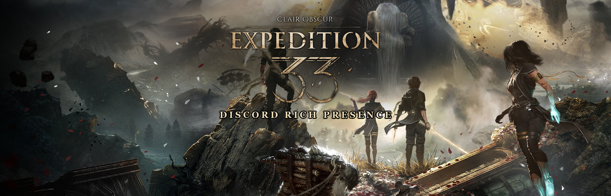
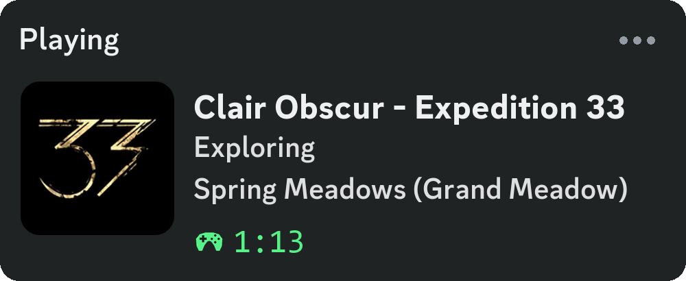
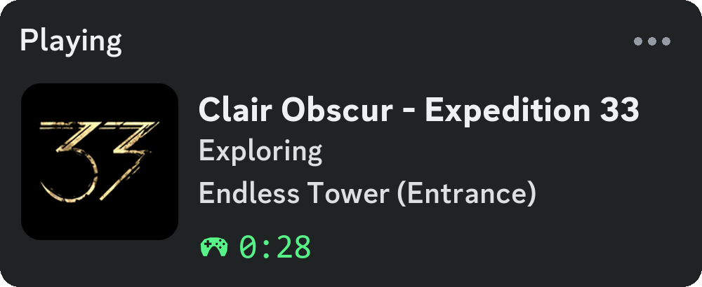
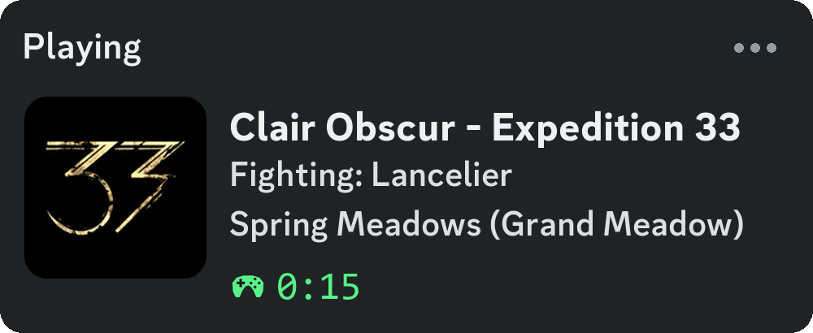

<p align="center">
  
</p>

<h1 align="center">Clair Obscur: Expedition 33 — Discord Rich Presence</h1>

<p align="center">
  <strong>An autonomous, lightweight companion bringing real-time dynamic presence for <em>Clair Obscur: Expedition 33</em> directly to your Discord profile.</strong>
</p>

<p align="center">
  <a href="https://github.com/SolaneHub/Expedition33_RPC/releases"></a>
  <a href="https://www.python.org/"></a>
  <a href="https://www.microsoft.com/windows"></a>
  <a href="https://github.com/astral-sh/ruff"></a>
  <a href="https://github.com/microsoft/pyright"></a>
  <a href="LICENSE"></a>
  <a href="#security"></a>
</p>

<p align="center">
  <a href="https://github.com/SolaneHub/Expedition33_RPC/releases/latest/download/Expedition33_RPC.exe">
    
  </a>
</p>

<p align="center">
  <a href="#showcase">Showcase</a> •
  <a href="#quick-start">Quick Start</a> •
  <a href="#tray-controls">Tray Controls</a> •
  <a href="#presence-matrix">Presence Matrix</a> •
  <a href="#development">Development</a> •
  <a href="#security">Security</a> •
  <a href="#license">License</a>
</p>

---

<h2 id="showcase">🎬 Showcase</h2>

| Exploration & Combat | Endless Tower | Anti-Spoiler Shield |
| :---: | :---: | :---: |
|  |  |  |
| Dynamic transition from exploration (`Spring Meadows`) to battle (`Fighting: Lancelier`). | Transition from entrance exploration (`Endless Tower (Entrance)`) to floor combat (`Stage 1, Trial 1`). | One-click tray shield masking locations (`Hidden Location`) and encounters (`In Combat`). |

---

<h2 id="quick-start">🚀 Quick Start</h2>

1. **Download**: Get the latest [`Expedition33_RPC.exe`](https://github.com/SolaneHub/Expedition33_RPC/releases/latest/download/Expedition33_RPC.exe) from Releases.
2. **Launch**: Double-click `Expedition33_RPC.exe`. It runs in your Windows system tray near the clock.
3. **Play**: Launch *Clair Obscur: Expedition 33* (Steam or PC Game Pass). Discord Rich Presence attaches automatically.

---

<h2 id="tray-controls">🎛️ System Tray Controls</h2>

Right-click the tray icon to monitor status and adjust preferences:

| Menu Item | Description |
| :--- | :--- |
| **Game Status** | Displays live PID or idle state (`Game: Running (PID: X)` / `Not running`) |
| **Location** | Current map zone (`[Hidden - Anti-Spoiler]` when masked) |
| **Status** | Real-time state (`In Combat` with enemy name / `Exploring`) |
| **Discord** | IPC named pipe status (`Connected` / `Standby`) |
| **Anti-Spoiler Mode** | Toggles masking for secret locations and encounter titles |
| **Combat Bridge** | Shows deployment status of the headless UE4SS mod or triggers manual install |
| **Start with Windows** | Toggles launch on Windows logon via `HKCU\...\Run` |
| **Check for Updates** | Checks GitHub Releases for new builds and performs in-place self-updates |
| **Exit** | Disconnects Discord RPC cleanly and closes the application |

---

<h2 id="presence-matrix">🎮 Presence Matrix</h2>

Presence dynamically updates to reflect current game activity:

| State | Details (Top Line) | State (Bottom Line) | Tooltip | Elapsed Timer |
| :--- | :--- | :--- | :--- | :--- |
| **Exploration** | `Exploring` | `<Zone Name> (<Flag Name>)` *(e.g. `Sirene (Dancing Classes)`)* | `Clair Obscur: Expedition 33` | Active session duration |
| **Combat Encounter** | `Fighting: <Enemy / Boss>` *(e.g. `Fighting: Lancelier`)* | `<Zone Name> (<Flag Name>)` | `Clair Obscur: Expedition 33` | Active session duration |
| **Endless Tower** | `Fighting: <Boss / Enemy>` | `Endless Tower (Stage <X>, Trial <Y>)` | `Clair Obscur: Expedition 33` | Active session duration |
| **Anti-Spoiler Shield** | `In Combat` *(or omitted during exploration)* | `Hidden Location` | `Clair Obscur: Expedition 33` | Active session duration |

> [!NOTE]
> Presences automatically adapt to the user's selected game language (supporting all 20 officially localized game languages via `game_data.json`).

---

<h2 id="development">🛠️ Development Guide</h2>

This project uses [`uv`](https://github.com/astral-sh/uv) for dependency management and execution.

```bash
# Sync virtual environment
uv sync

# Lint and format checks
uv run ruff check
uv run ruff format --check

# Static type checking
uv run pyright

# Run test suite
uv run pytest

# Build standalone executable
uv run python build_exe.py
```

Detailed architectural blueprints and system contracts are documented in [ARCHITECTURE.md](ARCHITECTURE.md). For contributor guidelines and agent directives, refer to [AGENTS.md](AGENTS.md).

---

<h2 id="security">🔒 Security & Verification</h2>

Release binaries are built in clean, isolated environments via GitHub Actions. Every release publishes verifiable cryptographic checksums:

| Artifact | SHA-256 Digest | Status | Report Link |
| :--- | :--- | :---: | :---: |
| **`Expedition33_RPC.exe`** | `fbaaa01ba5bf61d2034ce1b15fed58497674df3f5705b17432a37d10ddc8d9b5` | Clean | [🛡️ VirusTotal Report](https://www.virustotal.com/gui/file/fbaaa01ba5bf61d2034ce1b15fed58497674df3f5705b17432a37d10ddc8d9b5) |
| **`bridge.zip`** | `f5dc985bd9cb7c72c048c6ac1c29a8f920f89e9c3dc2e5d1aba336c5bd4eb82c` | Clean | [🛡️ VirusTotal Report](https://www.virustotal.com/gui/file/f5dc985bd9cb7c72c048c6ac1c29a8f920f89e9c3dc2e5d1aba336c5bd4eb82c) |

Verify the downloaded binary in PowerShell:
```powershell
Get-FileHash .\Expedition33_RPC.exe -Algorithm SHA256
```

---

<h2 id="license">📜 License</h2>

Licensed under the **[MIT License (with Attribution)](LICENSE)**. See the [LICENSE](LICENSE) file for complete details.

*Clair Obscur: Expedition 33* is a trademark of Sandfall Interactive / Kepler Interactive. This project is an unofficial community companion tool.
